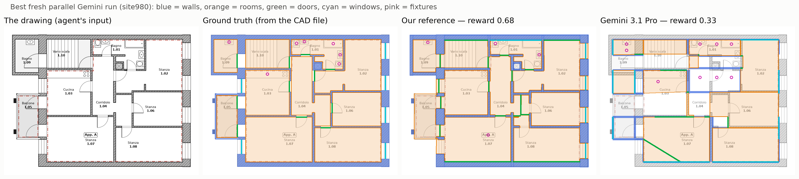
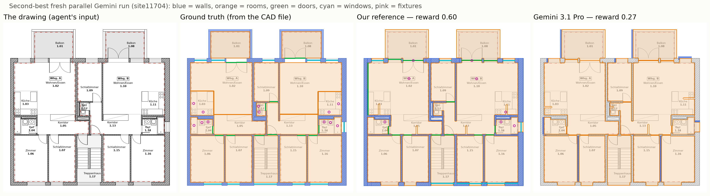

# Gemini 3.1 Pro: compact parallel benchmark

**Headline:** eight fresh Gemini episodes completed in two concurrent batches over distinct held-out plans. They used a median of **2 of 30** available tool calls and achieved **0.091 mean reward**. Four episodes submitted empty schematics; the two best reached 0.274 and 0.327. This is a reliability probe, not a replacement for the established 45-episode result.

## Why this matters for the challenge

The task is deliberately not a recognition-only test: an agent must inspect a floor plan, calibrate scale, trace geometry, and submit a machine-readable schematic. The agent had the same 30-call tool budget and the same hidden, CAD-derived scorer as every other evaluation. This compact run shows a particularly sharp failure mode: access to zooming and segmentation tools is not enough if the agent stops before turning those observations into walls, openings, fixtures, and calibrated areas.

## Fresh parallel runs

- **Model:** `gemini-3.1-pro-preview`
- **Date:** 14 November 2026
- **Protocol:** eight distinct held-out plans from the fixed 15-plan test split; one independent episode per plan; four launched together in each batch.
- **Budget:** 30 tool calls and an eight-minute episode limit per plan.
- **Scoring:** unchanged component-weighted reward against hidden surveyed geometry. Higher is better; 1.00 is a perfect schematic.
- **Elapsed wall time:** about 105 seconds across the two parallel batches (51 s and 54 s). Cumulative model episode time: 238 seconds.

| batch | held-out plan | reward | tool calls used | elapsed | observed submission |
|---|---|---:|---:|---:|---|
| 1 | `site1047_bldg2154_floor9740` | 0.056 | 3 / 30 | 51 s | Partial room-only output; no walls, openings, fixtures, or valid areas |
| 1 | `site279_bldg514_floor2041` | 0.000 | 1 / 30 | 6 s | Empty schematic |
| 1 | `site3259_bldg4943_floor22529` | 0.073 | 5 / 30 | 36 s | Eight room outlines; no walls, openings, fixtures, or valid areas |
| 1 | `site936_bldg1976_floor8706` | 0.000 | 1 / 30 | 4 s | Empty schematic |
| 2 | `site11704_bldg18258_floor48967` | 0.274 | 2 / 30 | 45 s | 12 walls and 12 rooms; strong room/area credit, no openings or fixtures |
| 2 | `site285_bldg527_floor51568` | 0.000 | 2 / 30 | 11 s | Empty schematic |
| 2 | `site4038_bldg6362_floor26166` | 0.000 | 3 / 30 | 31 s | Empty schematic after inspection and segmentation |
| 2 | `site980_bldg2055_floor9178` | 0.327 | 4 / 30 | 54 s | 57 walls, 10 rooms, 11 doors, 10 windows, and 9 fixtures |
| **pooled mean** | **8 distinct plans** | **0.091** | **2.6 / 30** | **30 s** | — |

Across all eight episodes, the mean component scores were **0.11 walls**, **0.19 rooms**, **0.01 doors**, **0.02 windows**, **0.05 fixtures**, and **0.06 areas**. The speed multiplier remained 1.00, but it multiplies earned geometry; finishing quickly does not improve an empty or incomplete answer.

## Visual evidence

The two strongest fresh runs are rendered below with the input drawing, hidden surveyed answer, drawing-only CV reference, and Gemini submission in the same image coordinates.





## Context: the defensible headline number

The compact batch is intentionally a smoke test, not a statistically stable model estimate. The benchmark's existing repeated evaluation is the right headline for the challenge:

| system | episodes | mean reward | what it establishes |
|---|---:|---:|---|
| Ground-truth replay | 15 | 1.000 | The scorer reaches its ceiling on correct geometry |
| CV reference, no answer key | 15 | 0.586 | A deterministic drawing-only baseline can extract substantial structure |
| Gemini 3.1 Pro, repeated runs | 45 | 0.342 | Frontier-agent performance across the full held-out split |
| **Gemini 3.1 Pro, fresh parallel probes** | **8** | **0.091** | Early-submission/reliability failure mode under concurrent evaluation |

The 45-episode result remains the appropriate performance claim. The two fresh batches add evidence that individual trajectories can collapse well before the call budget, and should be presented as a reliability stress signal rather than cherry-picked as a new average.

## Challenge-ready takeaway

> Frontier vision agents can see and query the drawing, yet still fail at the last mile of spatial work: measuring, tracing, checking, and committing to a complete structured answer. On this benchmark, the reference solver scores 0.586 without the answer key, while Gemini's established repeated result is 0.342; the new parallel probes expose an even more basic failure mode, where the agent frequently abandons almost the entire available interaction budget.

## Reproducibility

The raw episodes are stored in `runs/gemini-3.1-pro-parallel-20261114/` and `runs/gemini-3.1-pro-parallel-20261114-batch2/`. Aggregate figures and the full test-split table are refreshed in `results/summary.json` and `results/summary.md`. Each batch was launched as four independent invocations of:

```powershell
.venv\Scripts\python.exe -m blueprint_env.agent <held-out-task> `
  --model gemini-3.1-pro-preview --runs 1 --root tasks --out runs `
  --label gemini-3.1-pro-parallel-20261114
```

Then rescored with:

```powershell
.venv\Scripts\python.exe -m blueprint_env.evaluate --out results
```
